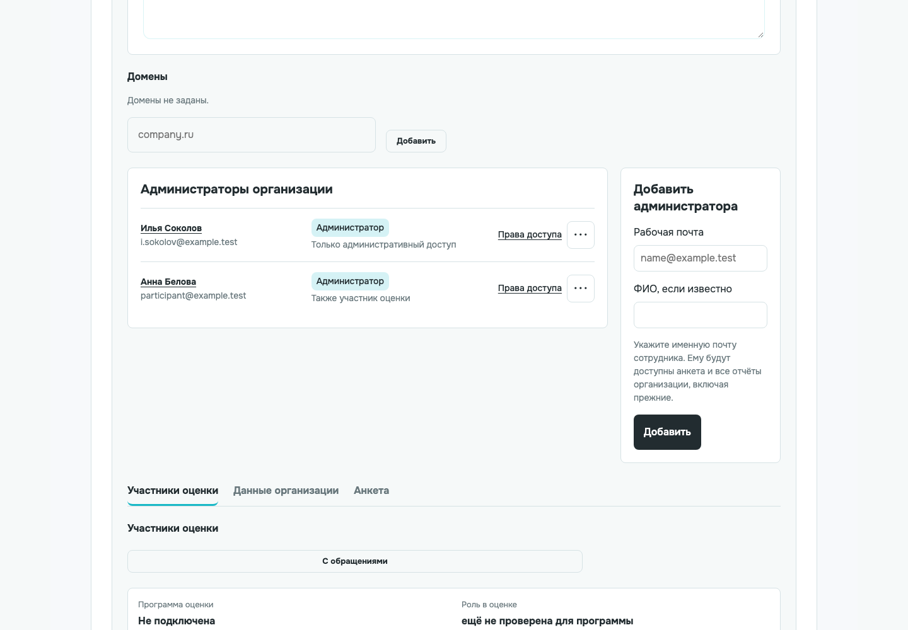
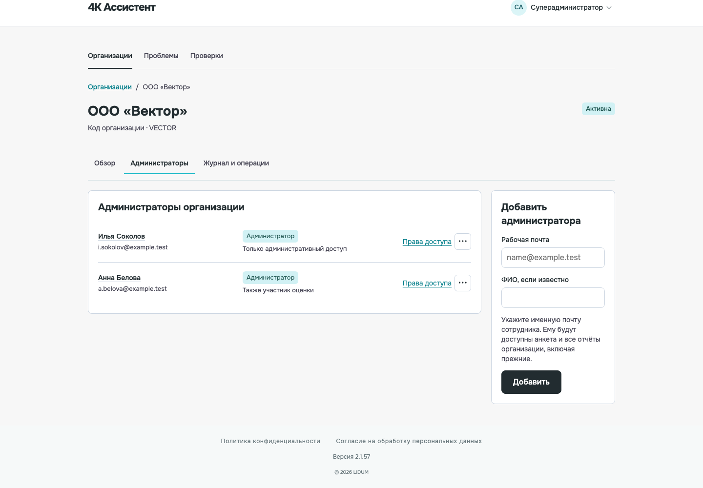

# P4K-SUP-UX-03 · Визуальная сверка

Снимки от 21.11.2026 для коммита [2af50394](https://github.com/VadikB/4K_MBTI/commit/2af50394dd6bc60ae54689c08d5b049d18006fbe) и [draft PR #280](https://github.com/VadikB/4K_MBTI/pull/280). Данные синтетические.

[Архив визуальной сверки](P4K-SUP-UX-03-visual-v1.6.zip) содержит 48 снимков, индекс, измерения и SHA-256. Основной экран сопоставлен с локальной копией v1.6 на 1440, 390 и 320 px. Для кабинета и архива приложены только снимки продукта, поскольку внешние эталоны вернули HTTP 401.

| Продукт, 1440 px | Референс v1.6, 1440 px |
| --- | --- |
|  |  |

[Меню строки на 390 px](product-390-actions.png) · [Подтверждение отзыва на 320 px](product-320-revoke.png)
